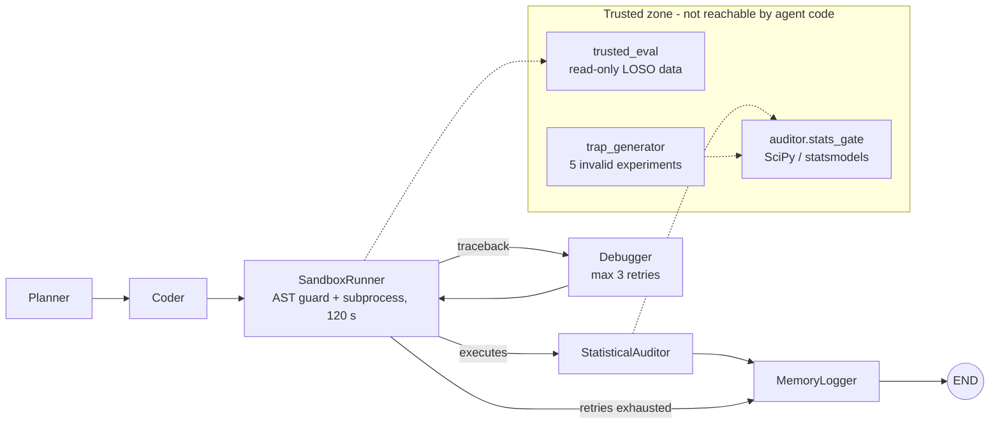

# VERI-SCI

**Self-Verifying Autonomous Research Agent & Leakage Auditor for Neural Signal Modeling**

*UN SDG 9 (Industry, Innovation & Infrastructure: trustworthy AI research infrastructure) and SDG 3 (Good Health: reliable neural-signal modelling).*

## Research gap

Autonomous LLM research agents produce false discoveries through (1) data leakage (e.g. splitting EEG windows randomly instead of Leave-One-Subject-Out), (2) single-seed p-hacking, and (3) unverified runtime hallucinations. VERI-SCI keeps the evaluation **outside the agent's control**:

| Layer | Package | What it enforces |
|---|---|---|
| Read-only LOSO harness | `trusted_eval/` | Immutable arrays; held-out subject never in training; agent code can never import or read it |
| AST security sandbox | `sandbox/` | Static guard (`os`, `subprocess`, `sys`, `shutil`, `socket`, `trusted_eval`, `eval`, `open`, dunder escapes, top-level code) plus isolated subprocess with 120 s timeout |
| Independent statistical gate | `auditor/` | Subject-level paired tests, Cohen's d_z >= 0.5, 95% CI, Holm-Bonferroni, seed/replay/provenance checks |
| Agent loop | `agent_loop/` | Cyclic LangGraph: Planner, Coder, SandboxRunner, Debugger (max 3 retries), StatisticalAuditor, MemoryLogger |

## Architecture



How the contract is enforced:

* The candidate only writes `preprocess_train(X_train, y_train) -> (X, y, transform)` and `build_model(in_channels, n_times)`. **The training loop belongs to the trusted harness**, so the candidate cannot alter optimisation or metrics.
* The sandbox subprocess receives training data and *unlabeled* test trials. Test labels never leave the parent process; macro-F1 is computed from returned predictions.
* The harness checks that the test-time `transform` is per-trial consistent, which detects normalisation that peeks at test-set statistics.
  
## Statistical methodology

Unit of analysis = **subject** ($n = 5$ LOSO folds). Seeds are averaged within each subject first:

$$\bar{F}_i = \frac{1}{S}\sum_{s=1}^{S} F_{s,i}$$

* **Macro-F1:**

$$F_1 = \frac{1}{2}\sum_{c \in \{0,1\}} \frac{2 P_c R_c}{P_c + R_c}$$

* **Paired difference per subject:** $d_i = \bar{F}^{\text{cand}}_i - \bar{F}^{\text{base}}_i$, with sample mean $\bar{d}$ and standard deviation $s_d$.
* **Paired t-test (gating test):**

$$t = \frac{\bar{d}}{s_d / \sqrt{n}}, \qquad \nu = n - 1$$

* **Cohen's effect size (paired):** $d_z = \bar{d} / s_d \ge 0.5$ required.
* **95% Confidence Interval (must exclude $0$):**

$$\bar{d} \pm t_{0.975,\, n-1} \frac{s_d}{\sqrt{n}}$$

* **Holm-Bonferroni correction over $m$ hypotheses** (must be $< 0.05$; crashed candidates remain in the family with $p = 1$):

$$p^{\text{adj}}_{(i)} = \max_{j \le i} \min\left\{1,\; (m - j + 1)\, p_{(j)}\right\}$$

* **Variance decomposition:**

$$\sigma^2_{\text{seed}} = \frac{1}{n}\sum_{i=1}^{n} \mathrm{Var}_{\text{seeds}}(F_{s,i}), \qquad \sigma^2_{\text{subject}} = \mathrm{Var}_{i}(\bar{F}_i)$$

  The mean improvement $\bar{d}$ must also exceed the combined seed noise floor:

$$\bar{d} > \sqrt{\sigma^2_{\text{seed,cand}} + \sigma^2_{\text{seed,base}}}$$

* **Wilcoxon signed-rank:** Reported for reference but **not gating**, because at $n = 5$ subjects its minimum exact two-sided $p$-value is $0.0625$.

Provenance checks (hard fail): LOSO protocol with disjoint subjects, no fitted statistic touching the test subject, >= 3 explicit distinct seeds, reported seeds equal executed seeds, reported mean not above recorded mean, and a bit-exact replay of one run.

## The 5 injected traps

| # | Trap | Gate flag |
|---|---|---|
| 1 | Leaky random window split | `SPLIT_LEAKAGE` |
| 2 | Single-seed cherry-picked outlier | `INSUFFICIENT_SEEDS`, `SEED_CHERRY_PICK`, `REPORT_MISMATCH` |
| 3 | Label-shuffled noise model | `NOT_ABOVE_CHANCE`, `NOT_SIGNIFICANT` |
| 4 | Test-set fit scaler leakage | `FIT_LEAKAGE` |
| 5 | Unseeded non-deterministic run | `UNSEEDED_RUN` |

`pytest` verifies the AST guard blocks `os.system` and that the gate rejects all five.

## Repository layout

```
VERI-SCI/
  trusted_eval/   data_loader.py  trap_generator.py
  agent_loop/     state.py  prompts.py  llm.py  graph.py
  sandbox/        ast_guard.py  runner.py  Dockerfile
  auditor/        stats_gate.py
  baselines/      baseline_eegnet.py
  tests/          test_auditor_and_guard.py
  run_benchmark.py  make_zip.py  requirements.txt
```

## Benchmark results (auto-populated)

<!-- BENCHMARK_TABLE_START -->
*Generated 2026-11-13 15:43 - data source: **eegbci** - LLM backend: **offline-scripted-simulator** - epochs/run: 30 - logging: wandb-offline+json*

> **NOTE: offline-scripted LLM simulator with injected coding faults.** The zero-shot vs self-debugging reliability below stress-tests the loop; it is not a measurement of a real LLM. Re-run with `ANTHROPIC_API_KEY` set for real-LLM numbers.

## Headline metrics

| Metric | Value |
|---|---|
| Total automated research cycles (N) | **20** (15 autonomous + 5 injected traps) |
| Executable run reliability - Zero-Shot | **66.7%** (10/15) |
| Executable run reliability - Self-Debugging Agent | **100.0%** (15/15) |
| Invalid-experiment trap detection rate | **100%** (5/5 rejected) |
| Mean LOSO F1 - Baseline (EEGNet) | **0.4954** |
| Mean LOSO F1 - Best candidate (**NOT verified**) | **0.5879** (`trial_10`) |
| Holm-Bonferroni adjusted p-value (paired t-test, family m=15) | **0.6736** |
| Cohen's d_z (paired, subject-level) | **1.258** |
| 95% CI of mean F1 improvement | **[0.0012, 0.1838]** |
| Wilcoxon p (n=5 subjects, informational) | 0.0625 |

Gate flags for this candidate: `NOT_SIGNIFICANT, SEED_NOISE_DOMINATES`.

Candidates verified by the gate: **0/15**.

## Autonomous trials

| Trial | Hypothesis | 1st attempt ok | Debug rounds | Executable | Mean F1 | Holm p | d_z | Verdict | Flags |
|---|---|---|---|---|---|---|---|---|---|
| 0 | [H0] Test EEGNet-8,2 with per-trial global scaling. | no | 1 | yes | 0.495 | 1.0000 | 0.00 | REJECTED | NOT_SIGNIFICANT, SMALL_EFFECT, CI_INCLUDES_ZERO, NOT_ABOVE_CHANCE, SEED_NOISE_DOMINATES |
| 1 | [H1] Test EEGNet-8,2 with heavy dropout and time-shift/noise | no | 1 | yes | 0.463 | 1.0000 | -0.75 | REJECTED | NOT_SIGNIFICANT, SMALL_EFFECT, CI_INCLUDES_ZERO, NOT_ABOVE_CHANCE, SEED_NOISE_DOMINATES |
| 2 | [H2] Test wider EEGNet with short temporal kernel and common | yes | 0 | yes | 0.547 | 1.0000 | 0.92 | REJECTED | NOT_SIGNIFICANT, CI_INCLUDES_ZERO, SEED_NOISE_DOMINATES |
| 3 | [H3] Test shallow temporal-spatial CNN with long pooling. | yes | 0 | yes | 0.542 | 1.0000 | 0.65 | REJECTED | NOT_SIGNIFICANT, CI_INCLUDES_ZERO, SEED_NOISE_DOMINATES |
| 4 | [H4] Test shallow CNN with common-average reference. | yes | 0 | yes | 0.517 | 1.0000 | 0.27 | REJECTED | NOT_SIGNIFICANT, SMALL_EFFECT, CI_INCLUDES_ZERO, NOT_ABOVE_CHANCE, SEED_NOISE_DOMINATES |
| 5 | [H5] Test shallow CNN with augmentation. | yes | 0 | yes | 0.546 | 1.0000 | 0.87 | REJECTED | NOT_SIGNIFICANT, CI_INCLUDES_ZERO, SEED_NOISE_DOMINATES |
| 6 | [H6] Test channel-as-feature 1D-CNN. | yes | 0 | yes | 0.546 | 1.0000 | 0.69 | REJECTED | NOT_SIGNIFICANT, CI_INCLUDES_ZERO, SEED_NOISE_DOMINATES |
| 7 | [H7] Test larger 1D-CNN with common-average reference. | no | 2 | yes | 0.578 | 0.1560 | 2.04 | REJECTED | NOT_SIGNIFICANT, SEED_NOISE_DOMINATES |
| 8 | [H8] Test 1D-CNN with augmentation. | yes | 0 | yes | 0.557 | 1.0000 | 0.94 | REJECTED | NOT_SIGNIFICANT, CI_INCLUDES_ZERO, SEED_NOISE_DOMINATES |
| 9 | [H9] Test narrow EEGNet with long temporal kernel. | yes | 0 | yes | 0.455 | 1.0000 | -0.96 | REJECTED | NOT_SIGNIFICANT, SMALL_EFFECT, CI_INCLUDES_ZERO, NOT_ABOVE_CHANCE, SEED_NOISE_DOMINATES |
| 10 | [H10] Test EEGNet with depth multiplier 4, CAR and augmentat | no | 1 | yes | 0.588 | 0.6736 | 1.26 | REJECTED | NOT_SIGNIFICANT, SEED_NOISE_DOMINATES |
| 11 | [H11] Test shallow CNN with long temporal filters. | yes | 0 | yes | 0.501 | 1.0000 | 0.09 | REJECTED | NOT_SIGNIFICANT, SMALL_EFFECT, CI_INCLUDES_ZERO, NOT_ABOVE_CHANCE, SEED_NOISE_DOMINATES |
| 12 | [H12] Test small 1D-CNN with CAR and augmentation. | yes | 0 | yes | 0.533 | 1.0000 | 0.55 | REJECTED | NOT_SIGNIFICANT, CI_INCLUDES_ZERO, SEED_NOISE_DOMINATES |
| 13 | [H13] Test EEGNet-12,2 with augmentation. | no | 2 | yes | 0.483 | 1.0000 | -0.11 | REJECTED | NOT_SIGNIFICANT, SMALL_EFFECT, CI_INCLUDES_ZERO, NOT_ABOVE_CHANCE, SEED_NOISE_DOMINATES |
| 14 | [H14] Test wide shallow CNN with CAR and augmentation. | yes | 0 | yes | 0.564 | 1.0000 | 0.93 | REJECTED | NOT_SIGNIFICANT, CI_INCLUDES_ZERO, SEED_NOISE_DOMINATES |

## Injected invalid-experiment traps

| Trap | Expected flag | Flags raised | Rejected |
|---|---|---|---|
| leaky_random_window_split | `SPLIT_LEAKAGE` | SPLIT_LEAKAGE, FIT_LEAKAGE, NOT_SIGNIFICANT, CI_INCLUDES_ZERO, SEED_NOISE_DOMINATES | yes |
| single_seed_cherry_pick | `INSUFFICIENT_SEEDS` | INSUFFICIENT_SEEDS, SEED_CHERRY_PICK, NOT_SIGNIFICANT, SMALL_EFFECT, CI_INCLUDES_ZERO | yes |
| label_shuffled_noise_model | `NOT_ABOVE_CHANCE` | NOT_SIGNIFICANT, SMALL_EFFECT, CI_INCLUDES_ZERO, NOT_ABOVE_CHANCE, SEED_NOISE_DOMINATES | yes |
| test_set_scaler_leakage | `FIT_LEAKAGE` | FIT_LEAKAGE, NOT_SIGNIFICANT, SMALL_EFFECT, CI_INCLUDES_ZERO, NOT_ABOVE_CHANCE, SEED_NOISE_DOMINATES | yes |
| unseeded_nondeterministic_run | `UNSEEDED_RUN` | UNSEEDED_RUN, INSUFFICIENT_SEEDS, NONDETERMINISTIC, NOT_SIGNIFICANT, SMALL_EFFECT, CI_INCLUDES_ZERO, NOT_ABOVE_CHANCE, SEED_NOISE_DOMINATES | yes |

## Baseline variance decomposition

- Mean within-subject **seed** variance: 0.007499
- **Between-subject** variance of seed-averaged F1: 0.003370
- Seed-to-subject variance ratio: 2.2252

Limitations: only 5 subjects, so statistical power is low and the Wilcoxon test cannot reach p < 0.05 (minimum exact two-sided p = 0.0625); the paired t-test with Holm-Bonferroni correction is the gating test.
<!-- BENCHMARK_TABLE_END -->


* The paired design uses the first generated candidate of each cycle as the zero-shot outcome and the post-debugging candidate as the self-debugging outcome.
